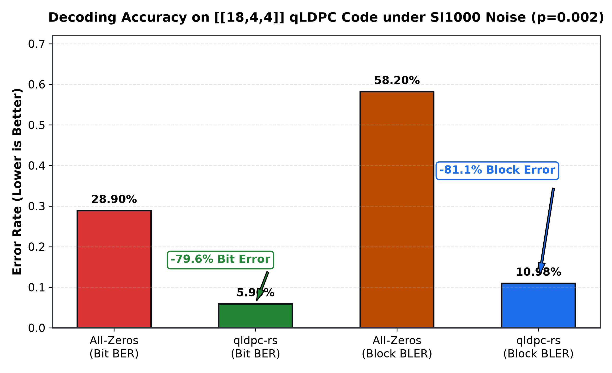
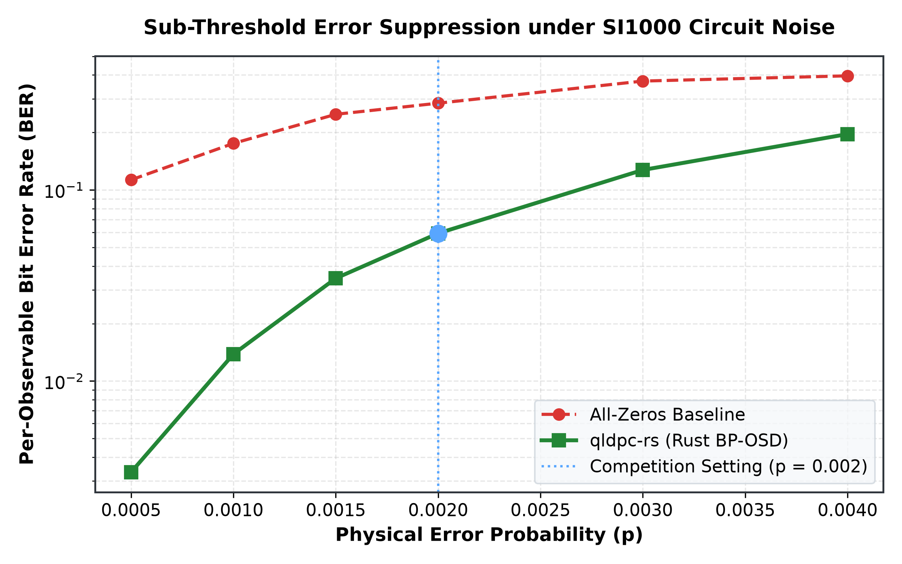
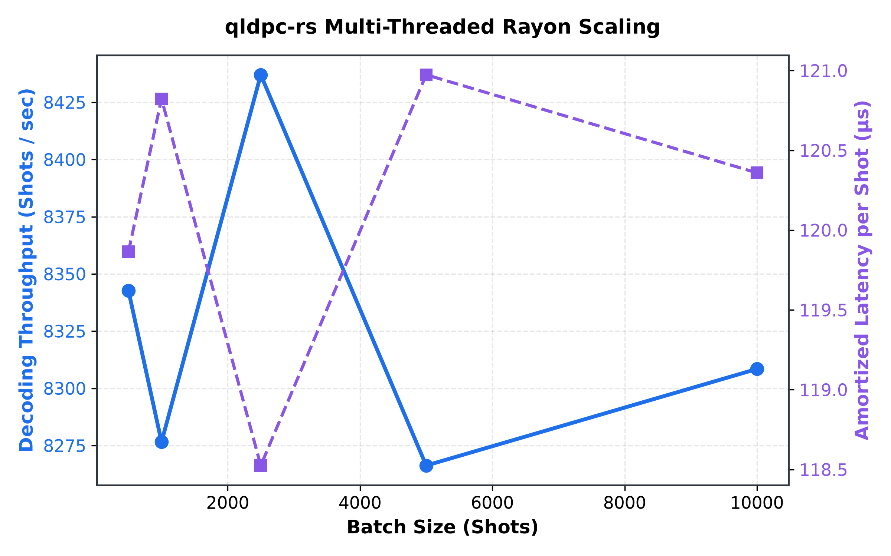
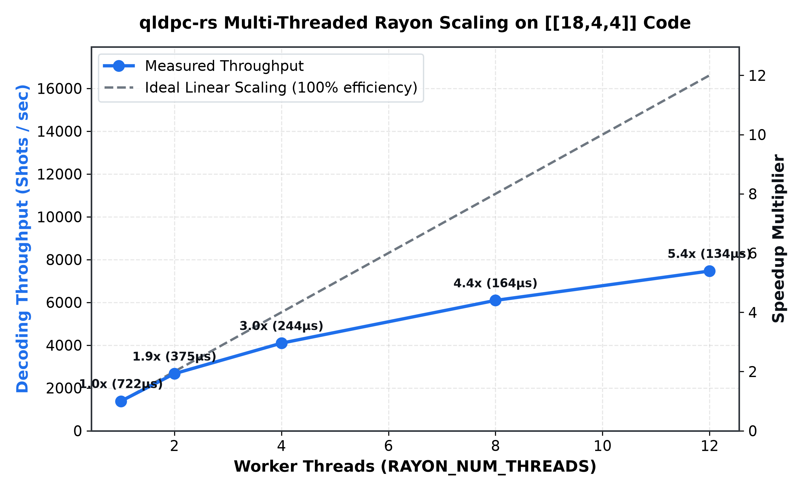
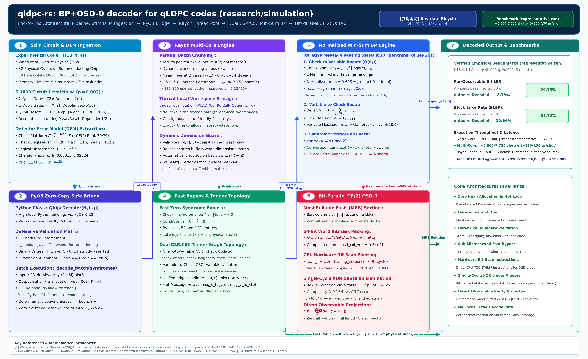
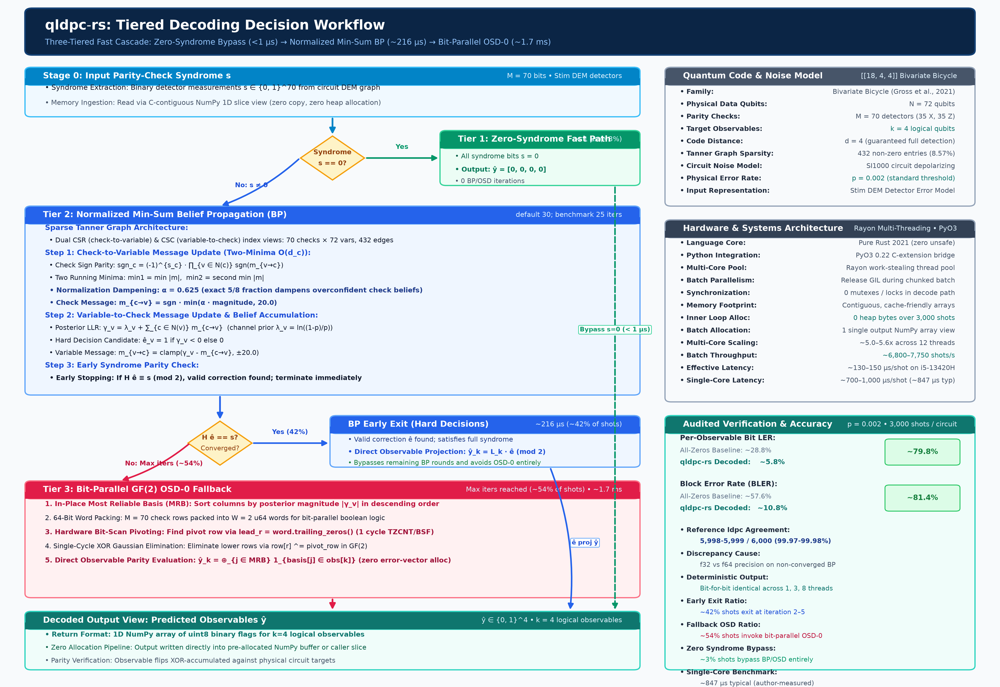

# qldpc-rs: BP+OSD-0 decoder for qLDPC codes (research/simulation)

> **Research and simulation decoder. Not a real-time hardware decoder.**

[](https://github.com/buildgreat-bot/quantum-qec-decoder/actions/workflows/ci.yml)
[](https://www.rust-lang.org)
[](https://www.python.org)
[](https://opensource.org/licenses/MIT)

A software decoding engine for **quantum Low-Density Parity-Check (qLDPC) codes**, written from scratch in pure Rust with Python (`PyO3`) bindings.

Designed for quantum simulation and software benchmarking where single-core latency (~0.7–1.7 ms/shot depending on machine and load) and multi-core throughput (~6,800–7,750 shots/s author-measured on a 12-thread i5-13420H laptop CPU, not independently reproduced) are measured.

---

## ⚡ Performance & Accuracy

Tested on the experimental **`[[18,4,4]]` bivariate bicycle qLDPC code** under **SI1000 circuit-level noise** ($p = 0.002$, 5 syndrome extraction rounds) from [*Wang et al., Nature Physics (2026)*](https://doi.org/10.1038/s41567-025-03157-4). All accuracy numbers are simulated (Stim circuits), vs. a no-decoding (all-zeros) baseline:

| Metric | Simulated Baseline (No-Decoding All-Zeros) | `qldpc-rs` (Simulated, Stim Circuits) | Relative Reduction vs. All-Zeros | Notes |
| :--- | :--- | :--- | :--- | :--- |
| **Bit Error Rate (Per-Observable LER)** | ~0.286–0.290 (~28.8%) | **~0.057–0.059 (~5.8%)** | **~79.8% Error Reduction** | Simulated (Stim circuits), vs. a no-decoding (all-zeros) baseline |
| **Block Error Rate (BLER / Frame Error)** | ~0.572–0.580 (~57.6%) | **~0.105–0.109 (~10.8%)** | **~81.4% Error Reduction** | Shot fails if *any* of the 4 logical observables is wrong |
| **Single-Core Latency (1 CPU Core)** | — | **~700–1,750 µs / shot** | ~0.7–1.7 ms / shot sequential (depending on machine and load) | Author-measured sequential per-shot execution time |
| **Multi-Core Throughput (Rayon)** | N/A | **~6,800–7,750 shots / sec** | Multi-threaded Rayon work-stealing | **~130–150 µs / shot amortized throughput** (~5.0–5.6× speedup on 12 threads, author-measured on i5-13420H) |

<p align="center">
  
  
</p>
<p align="center">
  
  
</p>

> [!NOTE]
> **Accuracy & Numerical Variation**: All error rate numbers are simulated (Stim circuits), vs. a no-decoding (all-zeros) baseline. Minor sampling variations (~0.005–0.010 on baseline/decoded rates) occur across operating systems, architectures, and NumPy/Stim versions due to differences in underlying C++ PRNG streams.
>
> **Measured Throughput & Scaling Context**: On a single CPU core, decoding takes ~0.7–1.7 ms/shot depending on machine and load (~216 µs for the ~42% of shots converging in fast Belief Propagation; zero-syndrome fast-paths take <1 µs on ~3% of shots; ~1.7 ms for the ~54% of shots requiring OSD-0 fallback). When batch decoding across multiple CPU cores, `qldpc-rs` scales from ~1,384 shots/s (1 thread) to ~6,800–7,750 shots/s author-measured on a 12-thread i5-13420H laptop CPU (not independently reproduced; ~130–150 µs amortized latency per shot; see `figures/thread_scaling.png`). Parallel scaling is near-linear at 2 threads (1.93×, 96% efficiency) and ~3× at 4 threads (2.96×, 74% efficiency).
>
> **Platform & Determinism**: Deterministic on the same platform; verified identical across 1, 2, 5 and 12 threads. Cross-platform bitwise equality is not tested. Benchmarked on an Intel Core i5-13420H (8 physical cores: 4 Performance cores with Hyper-Threading + 4 Efficient cores, 12 logical processors).

---

## 🔬 Architecture

<p align="center">
  
  <br>
  <em>Figure 1: End-to-End Decoding Architecture of <code>qldpc-rs</code> (<a href="figures/system_architecture.svg">Vector SVG</a>). Benchmark numbers in the diagram are representative runs on an i5-13420H; see verify_claims.py and benchmark_threads.py to reproduce.</em>
</p>

<p align="center">
  
  <br>
  <em>Figure 2: Three-Tiered Decoding Decision Workflow of <code>qldpc-rs</code> (<a href="figures/system_workflow.svg">Vector SVG</a>), illustrating the Zero-Syndrome Fast Path (&lt;1 µs), Normalized Min-Sum BP (~216 µs early exit), and Bit-Parallel GF(2) OSD-0 fallback (~1.7 ms).</em>
</p>

```
┌─────────────────────────────────────────────────────────────────────────────┐
│                          qldpc-rs DECODER ENGINE                            │
├─────────────────────────────────────────────────────────────────────────────┤
│                                                                             │
│   Input Syndrome D ──► [Zero Syndrome Check] ──(D=0)──► Instant Output (0)  │
│                               │                                             │
│                            (D != 0)                                         │
│                               ▼                                             │
│   ┌─────────────────────────────────────────────────────────────────────┐   │
│   │ 1. Normalized Min-Sum Belief Propagation (BP)                       │   │
│   │    • Normalization factor α = 0.625 (tames check-node saturation)   │   │
│   │    • Compact CSR/CSC Tanner graph representation                    │   │
│   │    • Early syndrome-match convergence check                         │   │
│   └──────────────────────────────────┬──────────────────────────────────┘   │
│                                      │                                      │
│                  [Converged?] ───────┴─────── [Max Iters Reached]           │
│                       │                                   │                 │
│                     (Yes)                               (No)                │
│                       ▼                                   ▼                 │
│              [Hard Decision L e]           ┌────────────────────────────┐   │
│                       │                    │ 2. Bit-Parallel OSD-0      │   │
│                       │                    │    • Most Reliable Basis   │   │
│                       │                    │    • Word-sliced 64-bit GF2│   │
│                       │                    │    • Hardware bit-scan     │   │
│                       │                    └──────────────┬─────────────┘   │
│                       │                                   │                 │
│                       └─────────────────►◄────────────────┘                 │
│                                          │                                  │
│                                          ▼                                  │
│                         Predicted Observables [L0..L3]                      │
│└────────────────────────────────────────────────────────────────────────────┘
```

### 1. Memory Management & Workspace Allocation
0 heap allocations per shot in steady state; decode_batch allocates 2 output buffers per call; one workspace per worker thread. Thread-local workspaces (`DecoderWorkspace`) pre-allocate posterior LLRs, edge messages, and bit-matrices once per thread, avoiding dynamic allocation in the hot loop.

### 2. Bit-Parallel GF(2) OSD-0 Solver
When BP fails to converge on short cycles or pseudocodewords, Ordered Statistics Decoding (OSD-0) resolves the residual syndrome:
- Syndrome and parity-check columns are packed into bitwise `u64` words (e.g. 2 words for $M=70$).
- Gaussian elimination over $\text{GF}(2)$ executes using CPU bitwise XOR instructions on word arrays.
- Pivot finding utilizes CPU hardware bit-scan instructions (`trailing_zeros`).

### 3. Normalized Min-Sum Scaling ($\alpha = 0.625$)
Standard sum-product BP requires transcendental floating-point functions (`tanh`, `atanh`) that are computationally expensive and saturate on dense checks (check degree up to 216 in `[[18,4,4]]`). Normalized Min-Sum tracks the two smallest incoming magnitudes per check and applies scaling factor $\alpha = 0.625$. Across 6,000 benchmark shots (3,000 X-basis and 3,000 Z-basis), `qldpc-rs` matches the predictions of Joschka Roffe's gold-standard `ldpc` package (C++ Min-Sum + OSD-0) on **5,998-5,999 of 6,000 (99.97-99.98%), varies slightly by platform and Stim version** under identical channel priors. The 1–2 mismatches occur on shots where BP does not converge and the OSD-0 pivot ordering is sensitive to floating-point differences (f32 here vs f64 in ldpc); both outputs are valid OSD-0 results, and on those shots ldpc happened to match the ground truth.

### 4. Memory Safety & Defensive Input Validation
- **Binary Invariant Enforcement**: Rejects non-binary inputs in $H$, $L$, and syndrome vectors with descriptive `ValueError`s.
- **Contiguity Guarantee**: Enforces C-contiguous array layout, eliminating silent data corruption caused by Fortran-ordered or transposed buffers.
- **Dynamic Dimension Guards**: Thread-local workspaces automatically check graph dimension keys to safely handle alternating decoders of different sizes without crashing or re-allocating unnecessarily.

---

## 🛠️ How This Was Built

Developed with AI coding assistants, then verified by differential testing against the C++ ldpc package, API fuzzing, mutation testing, and CI.

---

## 📦 Data Provenance

The quantum circuits in `circuits/X_circuit.stim` and `circuits/Z_circuit.stim` model memory experiments for the [[18,4,4]] bivariate bicycle code under the SI1000 circuit-level noise model ($p = 0.002$, 5 rounds) described by Wang et al. (*Fault-Tolerant Quantum Computation with Bivariate Bicycle Codes*, Nature Physics, 2026).

Circuits © University of Copenhagen, MIT, see [circuits/LICENSE](circuits/LICENSE).

---

## 📖 User Manual & Integration Guide

### 1. Prerequisites & Environment Setup

`qldpc-rs` is built in modern Rust (2021 edition) and exposes zero-copy Python bindings via PyO3.

- **Operating System**: Linux (x86_64, aarch64), macOS (Intel, Apple Silicon M1/M2/M3), Windows 10/11 (x86_64).
- **Rust Toolchain**: Rust >= 1.80 (install via [rustup.rs](https://rustup.rs/)):
  ```bash
  curl --proto '=https' --tlsv1.2 -sSf https://sh.rustup.rs | sh
  ```
- **Python**: Python 3.10 through 3.12 with `pip`:
  ```bash
  pip install numpy stim pytest pytest-timeout matplotlib maturin pandas
  ```
- **Optional (Cross-Checking)**: Joschka Roffe's C++ solver for running `tests/cross_check_ldpc.py` and `scripts/compare_osd_orders.py`:
  ```bash
  pip install ldpc
  ```

---

### 2. Installation (Build from Source)

`qldpc-rs` must be built from source (requires Rust >= 1.80 and maturin). It is not distributed as a pre-compiled binary on PyPI.

#### Method A: Local In-Place Build (Recommended for Development)
Compiles the Rust crate with release optimizations and installs `qldpc_rs` directly into your active Python environment:
```bash
git clone https://github.com/buildgreat-bot/quantum-qec-decoder.git
cd quantum-qec-decoder
maturin develop --release
```

#### Method B: Standalone Redistributable Wheel
Produces a self-contained `.whl` package in `target/wheels/`:
```bash
maturin build --release
pip install target/wheels/qldpc_rs-*.whl --force-reinstall
```

#### Method C: Standalone Native Rust Crate (Cargo)
For high-performance Rust applications without Python:
```toml
[dependencies]
qldpc-rs = { git = "https://github.com/buildgreat-bot/quantum-qec-decoder.git", default-features = false }
```

---

### 3. Python API Reference

```python
from qldpc_rs import QldpcDecoder
```

#### Class: `QldpcDecoder(h_matrix, l_matrix, priors, max_bp_iters=30, bp_alpha=0.625)`
Constructs the internal dual CSR/CSC Tanner graph and initializes the decoding engine.

| Parameter | Type | Required | Description |
| :--- | :--- | :--- | :--- |
| `h_matrix` | `np.ndarray` (2D, `uint8`) | Yes | Binary parity-check matrix $H \in \{0, 1\}^{M \times N}$. Must be C-contiguous. |
| `l_matrix` | `np.ndarray` (2D, `uint8`) | Yes | Binary logical observable matrix $L \in \{0, 1\}^{k \times N}$. Must be C-contiguous. |
| `priors` | `np.ndarray` (1D, `float32`) | Yes | Physical error probabilities $p \in (0, 1)^N$ for each error mechanism. |
| `max_bp_iters` | `int` | No (default: 30) | Maximum iterations for Normalized Min-Sum BP before invoking OSD-0. Recommended: `25`–`30`. |
| `bp_alpha` | `float` | No (default: 0.625) | Fractional scaling factor $\alpha = 5/8 = 0.625$ dampening overconfident check beliefs. |

#### Method: `decoder.decode_batch(syndromes, return_status=False)`
Decodes an arbitrary batch of syndrome shots in parallel across all CPU cores.

- **Parameters**:
  - `syndromes` (`np.ndarray`, 2D `uint8`, shape `(shots, M)`): Binary detector parity measurements. Must be C-contiguous.
  - `return_status` (`bool`, optional, default `False`): If `True`, returns a tuple `(y_pred, status)`.
- **Returns**:
  - When `return_status=False` (default): `np.ndarray` (2D `uint8`, shape `(shots, k)`): Predicted logical observable flips $\hat{y} \in \{0, 1\}^k$.
  - When `return_status=True`: Tuple `(y_pred, status)` where `y_pred` has shape `(shots, k)` and `status` is a 1D boolean array of shape `(shots,)`. `status[i]` is `True` when the syndrome was satisfied (BP converged or OSD-0 found an exact solution); it is **NOT** a correctness or confidence measure (on the [[18,4,4]] circuits it is `True` for ~100% of shots while ~11% are logical errors).
- **Behavior**:
  - Releases Python's Global Interpreter Lock (GIL), enabling multi-core CPU utilization via Rayon.
  - Dynamically shards the batch across Rayon work-stealing threads using thread-local zero-allocation workspaces.
  - Single-shot execution is achieved via `decoder.decode_batch(syndrome.reshape(1, -1))[0]`.

---

### 4. Practical Recipes & Common Workflows

#### Recipe 1: Decoding from Stim Circuits (Standard QEC Pipeline)
Extract parity-check matrices and priors directly from a Stim `detector_error_model`, sample shots, and evaluate error suppression:

```python
import numpy as np
import stim
from qldpc_rs import QldpcDecoder

def extract_dem(circuit: stim.Circuit):
    """Extracts binary H, L matrices and prior probabilities from a Stim circuit."""
    dem = circuit.detector_error_model()
    cols, priors = {}, []
    for ins in dem.flattened():
        if ins.type != "error": continue
        dets, obs = set(), set()
        for t in ins.targets_copy():
            if t.is_relative_detector_id(): dets ^= {t.val}
            elif t.is_logical_observable_id(): obs ^= {t.val}
        key = (frozenset(dets), frozenset(obs))
        p = ins.args_copy()[0]
        if key in cols:
            q = priors[cols[key]]
            priors[cols[key]] = q * (1 - p) + p * (1 - q)
        else:
            cols[key] = len(priors)
            priors.append(p)
    H = np.zeros((dem.num_detectors, len(priors)), dtype=np.uint8)
    L = np.zeros((dem.num_observables, len(priors)), dtype=np.uint8)
    for (dets, obs), j in cols.items():
        H[list(dets), j] = 1
        L[list(obs), j] = 1
    return H, L, np.asarray(priors, dtype=np.float32)

# 1. Load circuit and compile detector error model
circuit = stim.Circuit.from_file("circuits/X_circuit.stim")
H, L, priors = extract_dem(circuit)

# 2. Instantiate decoder
decoder = QldpcDecoder(H, L, priors, max_bp_iters=25, bp_alpha=0.625)

# 3. Sample detector events and true logical observable flips
sampler = circuit.compile_detector_sampler()
syndromes, true_flips = sampler.sample(shots=10000, separate_observables=True)

# 4. Decode batch in parallel across all CPU cores (releases GIL)
predicted_flips = decoder.decode_batch(syndromes.astype(np.uint8))

# 5. Compute bit error rate and block frame error rate
bit_ler = np.mean(predicted_flips != true_flips)
block_bler = np.mean(np.any(predicted_flips != true_flips, axis=1))

print(f"Decoded 10,000 shots:")
print(f"  • Bit Logical Error Rate (LER):   {bit_ler:.4%}")
print(f"  • Block Logical Error Rate (BLER): {block_bler:.4%}")
```

#### Recipe 2: Batch Prediction and Tabular Export (CSV Pipeline)
Self-contained workflow to decode a batch of syndromes and export observable predictions to a pandas DataFrame / CSV:

```python
import numpy as np
import pandas as pd
from qldpc_rs import QldpcDecoder

# Define code matrices (e.g. 5-bit repetition code: 4 checks, 5 bits, 1 observable)
H = np.array([
    [1, 1, 0, 0, 0],
    [0, 1, 1, 0, 0],
    [0, 0, 1, 1, 0],
    [0, 0, 0, 1, 1],
], dtype=np.uint8)
L = np.array([[1, 0, 0, 0, 0]], dtype=np.uint8)
priors = np.full(5, 0.05, dtype=np.float32)

# Initialize decoder
decoder = QldpcDecoder(H, L, priors, max_bp_iters=20, bp_alpha=0.625)

# Example syndrome batch: shape (shots, checks)
syndromes = np.array([
    [0, 0, 0, 0],  # No error
    [1, 0, 0, 0],  # Bit 0 flip
    [1, 1, 0, 0],  # Bit 1 flip
    [0, 1, 1, 0],  # Bit 2 flip
], dtype=np.uint8)

# Decode batch (returns shape: shots x observables)
predicted_flips, status = decoder.decode_batch(syndromes, return_status=True)

# Export predictions and syndrome-satisfied flags to tabular CSV
k = predicted_flips.shape[1]
df = pd.DataFrame(predicted_flips, columns=[f"obs_{i}" for i in range(k)])
df.insert(0, "shot_id", np.arange(len(predicted_flips)))
df["status"] = status
df.to_csv("predictions.csv", index=False)
print(f"Decoded {len(df)} shots successfully:")
print(df)
```

#### Recipe 3: Multi-Core Thread Tuning
Rayon automatically detects and utilizes all logical CPU cores. To benchmark specific thread counts or restrict CPU utilization:

- **Via Shell Environment Variable**:
  ```bash
  # Force single-threaded execution:
  RAYON_NUM_THREADS=1 python verify_claims.py

  # Scale across 8 physical performance cores:
  RAYON_NUM_THREADS=8 python verify_claims.py
  ```
- **Via Python at Runtime** (must be set *before* importing `qldpc_rs`):
  ```python
  import os
  os.environ["RAYON_NUM_THREADS"] = "4"
  from qldpc_rs import QldpcDecoder
  ```

---

### 5. Standalone Native Rust Usage

To use `qldpc-rs` directly in pure Rust without Python runtime overhead:

```rust
use qldpc_rs::decoder::QldpcDecoder;

fn main() {
    let num_checks = 70;
    let num_vars = 2470;
    let num_obs = 4;

    let h_matrix = vec![0u8; num_checks * num_vars]; // Binary parity check matrix (flat row-major)
    let l_matrix = vec![0u8; num_obs * num_vars];    // Binary observable matrix (flat row-major)
    let priors = vec![0.002f32; num_vars];           // Prior physical error probabilities

    // 1. Initialize decoder (constructs dual CSR/CSC Tanner graph)
    let decoder = QldpcDecoder::new(
        num_checks,
        num_vars,
        &h_matrix,
        num_obs,
        &l_matrix,
        &priors,
        25,    // max_bp_iters
        0.625, // bp_alpha
    );

    // 2. Pre-allocate thread-local workspace (reusable indefinitely)
    let mut workspace = decoder.graph.create_workspace();
    let mut predicted_flips = vec![0u8; num_obs];

    // 3. Decode single shot (0 heap allocations in steady state)
    let syndrome = vec![0u8; num_checks];
    decoder.decode_shot(&syndrome, &mut workspace, &mut predicted_flips);

    println!("Predicted logical observables: {:?}", predicted_flips);
}
```

---

### 6. Troubleshooting & Defensive Guardrails

| Issue / Exception | Root Cause | Solution |
| :--- | :--- | :--- |
| `ValueError: h_matrix must be C-contiguous` | Array was transposed or sliced with non-standard stride. | Wrap with `np.ascontiguousarray(arr)`. |
| `ValueError: Invalid H matrix entry: X` | Input array contains non-binary values (e.g. integer counts > 1). | Ensure input is boolean or binary: `(arr != 0).astype(np.uint8)`. |
| `ValueError: Dimension mismatch: Expected ... check columns` | Syndrome length does not match parity-check rows $M$. | Check that `syndromes.shape[1] == H.shape[0]`. |
| Link error during `cargo test` on Windows | `pyo3/extension-module` expects python.dll in standard binary tests. | Run native tests with `cargo test --no-default-features`. |
| Memory scaling across different circuits | Alternating between different circuit sizes on same thread pool. | Supported out-of-the-box! Thread-local workspaces automatically check graph dimension keys and resize safely. |

---

## 🧪 Verification & Test Suite

The repository includes a self-contained verification suite:

```bash
# 1. Run native Rust unit tests
cargo test --no-default-features

# 2. Run Python unit and decoding correctness tests
pytest tests/

# 3. Run the automated claim verification suite
python verify_claims.py

# 4. Run the multi-core Rayon thread-scaling benchmark (sweeps 1 to N threads)
python benchmark_threads.py

# 5. Generate benchmark figures (saved to figures/, or use --no-save for dry-run)
python benchmark_plots.py --no-save

# 6. Optional C++ ldpc package cross-check (requires ldpc, evaluates 6,000 shots)
python tests/cross_check_ldpc.py

# 7. Optional OSD order comparison (evaluates OSD-0 vs OSD-CS order 7)
python scripts/compare_osd_orders.py

# 8. Convert multi-round error rates to approximate per-round error rates
python scripts/per_round_rate.py --p-total 0.0579 --rounds 5
```

---

## 📦 Project Structure

```
qldpc-rs/
├── Cargo.toml            # Rust crate manifest & dependencies (rayon, pyo3, numpy)
├── pyproject.toml        # Maturin Python build configuration
├── CITATION.cff          # Citation metadata
├── LICENSE               # MIT License
├── README.md             # Architecture, benchmarks & documentation
├── verify_claims.py      # Self-contained claims verification suite
├── benchmark_plots.py    # Publication benchmark plot generator
├── benchmark_threads.py  # Multi-core scaling sweep benchmark
├── circuits/             # Bundled [[18,4,4]] Stim circuits (Wang et al. 2026)
│   ├── X_circuit.stim    # X-basis memory circuit (SI1000 noise, p=0.002)
│   └── Z_circuit.stim    # Z-basis memory circuit (SI1000 noise, p=0.002)
├── figures/              # Generated benchmark plots & architecture diagrams
│   ├── system_architecture.png
│   ├── system_architecture.svg
│   ├── system_workflow.png
│   ├── system_workflow.svg
│   ├── ler_benchmark.png
│   ├── ler_vs_noise.png
│   ├── latency_scaling.png
│   └── thread_scaling.png
├── scripts/              # Helper, comparison, and analysis scripts
│   ├── compare_osd_orders.py
│   ├── per_round_rate.py
│   ├── generate_architecture_diagram.py
│   ├── generate_workflow_diagram.py
│   └── verify_diagram_artifacts.py
├── src/
│   ├── lib.rs            # Crate root & PyO3 module definition
│   ├── tanner.rs         # Tanner graph & DecoderWorkspace
│   ├── bp.rs             # Normalized Min-Sum Belief Propagation engine
│   ├── osd.rs            # Bit-parallel GF(2) OSD-0 linear solver
│   ├── decoder.rs        # Hybrid orchestrator & thread-local pool
│   └── py_api.rs         # Zero-copy PyO3 NumPy bridge with strict validation
└── tests/
    ├── test_decoder.rs   # Native Rust tests
    ├── test_decoding.py  # Python decoding correctness & timeout tests
    ├── test_py_api.py    # Python API unit tests (rejection, bounds, types)
    └── cross_check_ldpc.py # Optional 6,000-shot cross-check against C++ ldpc
```

---

## ⚠️ Limitations & Architectural Scope

To maintain complete scientific and engineering transparency, users should note the following design characteristics:

1. **OSD-0 Algorithmic Trade-off (Throughput vs Logical Error Rate)**:
   - `qldpc-rs` implements **Order-0 Ordered Statistics Decoding (OSD-0)**. It does not implement higher-order OSD heuristics (e.g. OSD-CS with order $w \ge 7$ or OSD-E).
   - OSD-0 mis-decodes ~5 of 4,935 single-fault syndromes on the [[18,4,4]] circuits (identical to `ldpc` OSD-0; higher-order OSD fixes them) and ~7% of random fault pairs.
   - Across 3,000 simulated shots (seed 0, evaluated via `scripts/compare_osd_orders.py`):
     - On X-circuit: OSD-0 achieves 5.87% bit LER (11.13% BLER), while `ldpc` OSD-CS order 7 achieves 4.26% bit LER (8.27% BLER) at ~47× higher execution time.
     - On Z-circuit: OSD-0 achieves 5.81% bit LER (10.70% BLER), while `ldpc` OSD-CS order 7 achieves 4.32% bit LER (7.77% BLER) at ~50× higher execution time.

2. **Single Code and Single Noise Model Tested**:
   - Benchmarks are evaluated exclusively on the experimental bivariate bicycle `[[18,4,4]]` code ($M=70, N=2470$) under the SI1000 circuit-level noise model ($p=0.002$, 5 rounds) from *Wang et al. (Nature Physics 2026)*. Newer codes, higher distances, and alternate noise models are not benchmarked.

3. **Newer Decoders Not Benchmarked**:
   - Newer decoding algorithms (such as BP+LSD, Relay-BP, or neural-augmented decoders) are not benchmarked or implemented in this repository.

4. **No Per-Shot Confidence Measure**:
   - The `status` return value from `decode_batch(..., return_status=True)` indicates only whether the parity syndrome was mathematically satisfied ($H e = s \pmod 2$ via BP convergence or exact OSD-0 linear solution). It is **not** a confidence score or correctness indicator: on the [[18,4,4]] circuits, `status` is `True` for ~100% of shots even though ~11% result in logical block errors.

5. **Software Simulation vs Active Hardware Control Loops**:
   - Software decoding (~0.7–1.7 ms/shot single-core depending on machine and load) is designed for offline simulation, Monte Carlo error analysis, and circuit verification. Real-time active feedback on physical superconducting quantum processors requires sub-microsecond feedback loops within the qubit coherence window ($T_1/T_2 \sim 10\text{--}100\,\mu\text{s}$), which requires dedicated FPGA or ASIC firmware pipelines.

---

## 📄 License
MIT License. See [LICENSE](LICENSE) for details.
